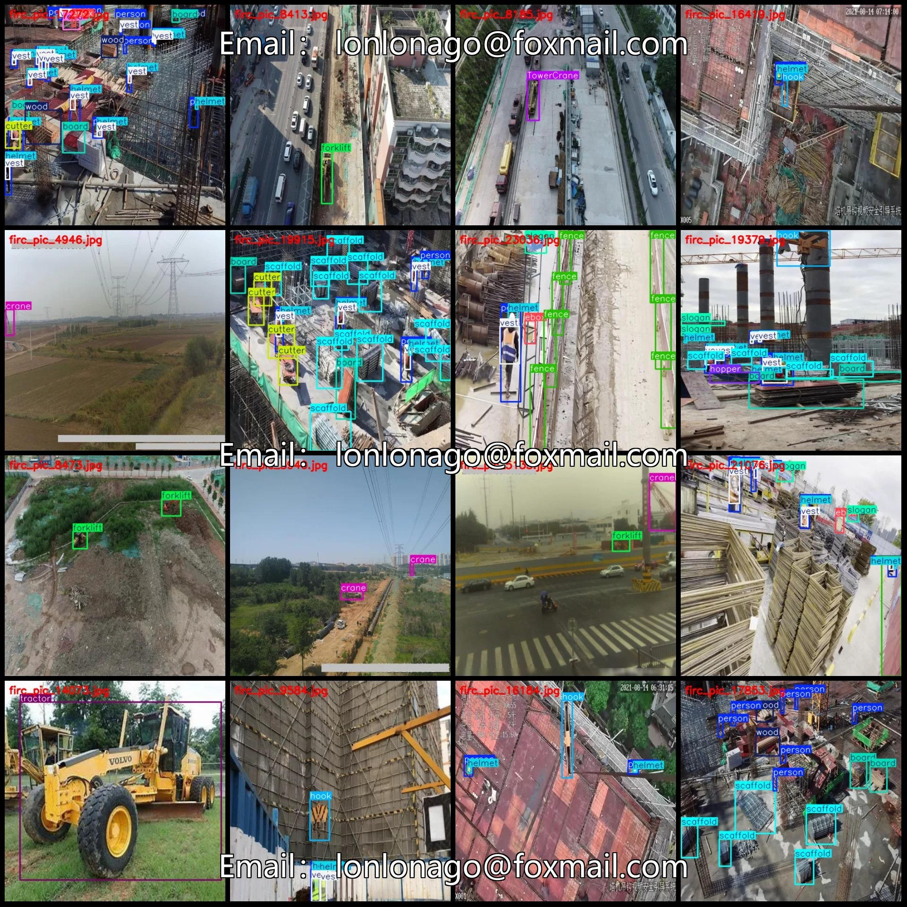
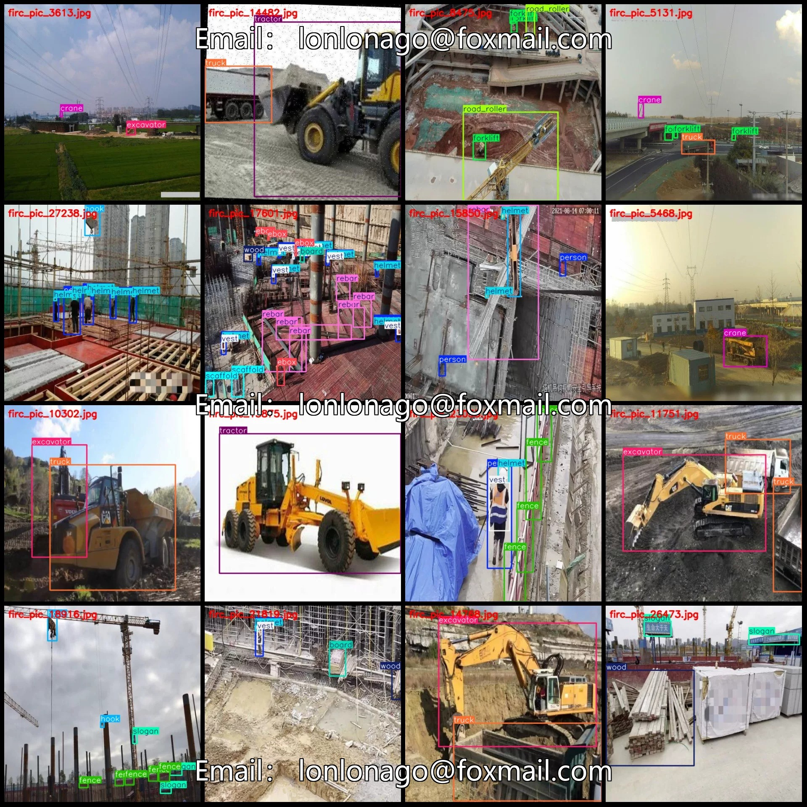
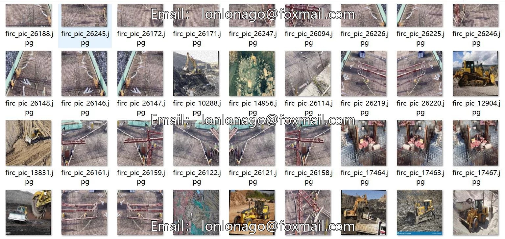

# Construction Machinery Personnel Materials Construction Elements Target Test Data Set VOC+YOL

## Body

Building site construction machinery personnel material construction elements target detection dataset VOC+YOLO format 27278 images 26 categories
Tips: Due to the dataset's replicability, please confirm compliance before purchasing.
Dataset format: Pascal VOC format + YOLO format (txt file without split path, only containing jpg images and corresponding VOC format xml files and yolo format txt files)
Number of images (number of jpg files): 27278
Number of annotations (number of xml files): 27278
Number of annotations (number of txt files): 27278
Number of annotation categories: 26

Label category names (Note that the order of yolo format categories does not correspond to this, but is based on the labels folder's classes.txt): ["BirdCarcass", "ForeignObject", "PileDriver", "TowerCrane", "board", "brick", "concrete_mixer_truck", "crane", "cutter", "ebox", "excavator", "fence", "forklift", "handcart", "helmet", "hook", "hopper", "person", "r"]

ebar, road roller, scaffold, slogan, tractor, truck, vest, wood

Number of boxes labeled in each category
BirdCarcass (bird carcass) Frame Count = 65
ForeignObject ((Non-standard) Frame count = 15
PileDriver (pile driver) Frames = 822
TowerCrane (Tower Crane) Frame Count = 12190
Board (Wooden board) Frame Count = 8347
brick (tile) count = 2246
concrete_mixer_truck (Cement mixer truck) Number of frames = 1270
Crane (crane) Frame Count = 15082
Cutter (Cutting Machine) Frame Count = 1203

ebox (electric box/electrical box) Frames = 5629
excavator (excavator) Frames = 5830
fence (fence) Frames = 5588
forklift (forklift) Frames = 3072
handcart (handcart) Frames = 831
helmet (safety hat) Frames = 37256
hook (hook) Frames = 5649
hopper (hopper) Frames = 3516
person (person) Frames = 48865
rebar (rebar) Frames = 4483
road_roller (roller) Frames = 372

Scaffold (scaffold) Frames = 17241
Slogan (slogan) Frames = 12227
Tractor (tractor) Frames = 3528
Truck (truck) Frames = 7586
Vest (vest) Frames = 31474
Wood (wood) Frames = 11707
Total Frames: 246094
Number of Images per Category
BirdCarcass (bird carcass) Number of Images = 28
ForeignObject (foreign object) Number of Images = 14
PileDriver (pile driver) Number of Images = 467

TowerCrane (tower crane) occupies a picture count = 3613
Board (Wooden board) occupies a picture count = 4211
brick (tile) occupies = 1146
concrete_mixer_truck (Concrete mixer truck) occupies the number of pictures = 984
crane (crane) occupies a picture count = 5892
Cutter (Cutting Machine) occupies the image count = 847
ebox (electric box/electrical box) occupies a picture count = 3329
Excavator (excavator) occupies a picture count = 3879
Fence

## Images

## Payment

Here is a pay link on Stripe ( https://buy.stripe.com/3cs8yP7sY87d0vu9AB ). Please contact me lonlonago@foxmail.com after funding $89, and I will send you a complete data files , thank you!

